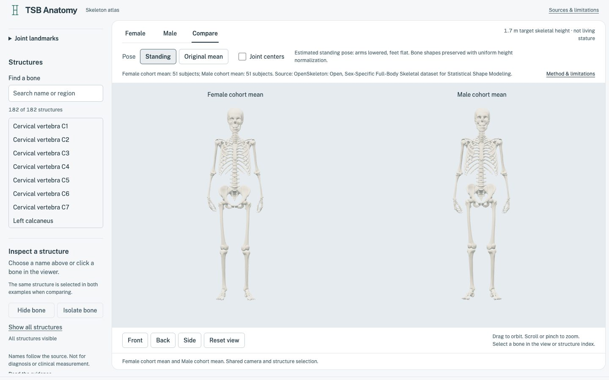

# TSB-Anatomy

Open, source-traceable skeletal anatomy for inspection and collaborative correction.

**Anatomy: CC BY-SA 4.0. Software: MIT. Upstream OpenSkeleton: CC BY 4.0.** See [ATTRIBUTION.md](ATTRIBUTION.md) for the exact scope and credited creators.

The atlas builds female and male **cohort means**, not ideal humans or individual specimens. Both are normalized to a **1.70 m skull-to-foot skeletal extent** for comparison. This is not measured living stature.

**Status: unreviewed anatomical research/visualization output. Not clinically validated.** Numerical checks are not anatomical or clinical validation. Do not use this release as a validated diagnostic, treatment, surgical-planning or measurement tool. These limitations do not add restrictions to the open licenses.



## Open the viewer

```sh
npm ci
npm run dev
```

The repository includes the generated models; viewing does not require Python or the raw CT-derived dataset. The initial load includes both detailed skeletons.

- Switch between female, male and side-by-side comparison.
- Switch **Standing / Original mean** to compare the estimated display pose with the saved source-derived mean, including crossed arms and original foot positions. Camera, selection and hidden structures are preserved.
- Enable **Joint centers** to see 14 estimated pivots per skeleton and the selected pivot's local XYZ axes. Select a joint in either comparison pane or the native **Joint landmarks** selector; selection is shared.
- The read-only joint inspector shows model-space coordinates in meters, parent node, estimation method, available head-fit residuals and directly attached structures. Fit residuals are not anatomical accuracy estimates; the local triads are not validated joint-motion axes. On mobile, **View selected joint** returns to the canvas.
- Drag to orbit and scroll to zoom. The default/reset view is slightly elevated; front/back/side are exact orthographic inspection views. Skeletons appear against the plain slate background, without a visible floor, ground outline or cast shadows.
- Search/select a structure or click its geometry.
- Hide a structure, isolate it, or restore all structures. Selection and visibility are shared across comparison views.
- Focus the canvas and use arrow keys to orbit, `+`/`-` to zoom, and `Home` for the front view. Every structure is also selectable without the canvas.
- Source, normalization, review status and limitations are available below the viewer.

## What is included

The source inventory contains **182 named structures**, **720,895 vertices** and **1,441,369 triangles** per skeleton. Each exported mean retains all vertices and has **1,441,368 triangles** after removing one proven inherited zero-area sternum face. Both sex groups contain 51 subjects; all are equally weighted. See [reports/generation.json](reports/generation.json) for exact counts and mesh audit results.

The inventory covers the combined skull, mandible, vertebrae, ribs, sternum, shoulder girdle, upper limbs and hands, pelvis, lower limbs and feet. The source's names are preserved as stable IDs, with readable labels in the manifest.

**182 structures does not mean 182 individual anatomical bones.** The skull is combined. Teeth, individual cranial bones, auditory ossicles, hyoid and coccyx are not separately identified in this inventory. No muscles, organs, cartilage or ligaments are included.

Known topology findings in both means: `HandScaphoid_L`, `HandScaphoid_R`, `Head` and `Sacrum` are not watertight; `Femur_L` and `Femur_R` have inconsistent face winding. These are review targets, not silently repaired surfaces. Double-sided viewing does not fix the source topology. Sternum face **3731** (zero-based source face index) was removed only after verifying exactly zero area in all 51 contributing specimens of each sex.

The viewer opens in the **standing display pose**: relaxed shoulder girdles, arms at sides, and level heels/forefeet aligned to an invisible mathematical plane at Y=0. No earth or floor surface is rendered. Bones articulate rigidly; arches are not flattened. One whole-body uniform scale restores the 1.70 m skeletal height after foot placement. These are estimated pose adjustments, not a validated neutral or weight-bearing stance. **Original mean** restores the saved normalized cohort pose, not an individual CT specimen. The source-derived means remain unchanged in `data/derived/*.npz`.

## How the averages are made

1. Download a pinned complete OpenSkeleton release and verify every required file's published size and MD5. MD5 here checks transfer integrity against the source, not authenticity against a malicious publisher.
2. Read sex groups from the source's recorded `sex_code`; do not infer gender identity. No cause-of-death, medical-history or other personal metadata is copied into the atlas.
3. Require identical structure inventories, vertex counts and canonical triangular connectivity for every subject. Anatomical vertex correspondence itself is supplied by OpenSkeleton, not independently established by these checks.
4. Establish one right-handed frame per whole skeleton: superior axis from mean heel centers toward the skull centroid; left axis from right to left hip-bone centroids, orthogonalized against superior; anterior axis from their cross product. Check that the sternum lies anterior to T8. The pelvis midpoint sets the horizontal origin.
5. Ground each skeleton at its lowest foot vertex and uniformly scale its skull-to-foot extent to the requested height. The same transform is applied to every structure; individual bones are not independently fitted or stretched.
6. Take an equal-weight arithmetic mean of corresponding vertices within each sex group.
7. Ground and uniformly scale each mean again to restore the exact requested extent: averaging can slightly shrink the extrema. No smoothing or decimation is applied.
8. Remove an exactly zero-area triangle only after proving it has exactly zero area in every contributing source specimen; record its zero-based source face index. Reject new or near-degenerate collapses rather than silently repairing them.
9. Preserve float64 reference arrays in NPZ in their original mean pose. Estimate joint pivots; relax the shoulder girdles and articulate the arms; level each rigid foot onto a three-region support plane and solve connected hip/knee chains. Translate the whole skeleton onto Y=0 and uniformly rescale the entire posed skeleton to the requested height. Export named meshes under glTF transform nodes; record rest/posed matrices, contact vertices, landmark methods, topology, bounds and file hashes.

Coordinates are meters, **X = anatomical left, Y = superior, Z = anterior**. Both means share the same conventions and baseline.

### Pose and rigging

Each GLB has **182 rigid mesh objects** and **15 transform nodes** for the standing pose: one `stance` normalization node, and two chains per side: `girdle_L → shoulder_L → elbow_L → wrist_L` and `hip_L → knee_L → ankle_L` (plus their `_R` counterparts). The girdle carries the clavicle/scapula and arm; the hip carries the femur/patella; the knee carries tibia/fibula; the ankle carries all foot structures. Mesh vertices are local to their original joint pivot. All articulated nodes use rigid transforms; only the common `stance` node applies uniform height normalization.

These are ordinary glTF nodes, **not a skinned character or Blender armature**. The export pipeline uses an offline two-link leg-position solve, but there is no interactive IK controller, biomechanical joint-limit system, independent finger/toe articulation, spine rig or animation clip. Wrist rotation and internal hand/foot shapes are inherited from the source. The head and torso retain their source posture relative to each other.

Pivots are explicitly **estimated display landmarks**:

- Shoulder girdle: estimated sternoclavicular pivot at the medial 10% clavicle vertex centroid; the lateral 10% centroid defines elevation. The source means measure about 31° outward elevation. Clavicle and scapula move together to a **10° display target**, which is not asserted to be a clinical normal value. Their mutual relationship is preserved, but scapulothoracic glide is not modeled.

- Shoulder: sphere fit to the medial half of the proximal 18% of humeral vertices along its principal axis. Fit radii and residuals are reported.
- Elbow: centroid of the distal 12% of the humeral surface along that axis. The estimated bending plane comes from the upper-arm and forearm directions, not independently identified epicondyles. A circular articular-surface assumption was rejected because it fit the available surface poorly.
- Wrist: midpoint of the lunate/scaphoid vertex centroids. The complete hand moves with the forearm, preserving their existing relationship.
- Hip: sphere fit to the medial 45% of the proximal 8% femoral cap, excluding the neck/trochanter. Knee: distal 12% femoral vertex centroid. Ankle: superior-quartile talus centroid. The patella follows the femur; physiological patellar tracking is not modeled.
- Foot support: retain the complete foot as a rigid assembly and solve pitch/roll so the heel, medial forefoot and lateral forefoot support minima share a plane. Check every foot vertex against that plane. Current supports occur on the calcaneus, first-ray sesamoids and lateral metatarsals; exact structures/vertex indices are recorded. Soft-tissue soles and heel pads are absent.

`reports/generation.json` records every joint's parent, attached structures, `sourcePivotM`, `localMatrix`, and `restLocalMatrix`, plus support contacts, normalization and reference SHA256 hashes. Matrices are row-major JSON arrays acting on column vectors. Applying **all** rest matrices, including `stance`, restores the original mean. The pose retains segment lengths before one common whole-body scale; no bone is independently stretched. Foot placement stays at the source ankle X/Z locations; one leg reaches the 5° minimum knee-flexion target while source asymmetry leaves the other at approximately 12–13°. These are display-solver results, not physiological measurements. Surface congruence, cartilage spacing, scapula/rib collisions and weight-bearing mechanics remain **unvalidated**.

The complete rig report is also embedded in each GLB's scene extras as `rig` (`gltf.scene.userData.rig` in Three.js), including its source-reference hash. No separate report download is needed for pose switching or landmark inspection. The viewer applies every saved matrix, including the stance normalization, rather than editing vertices or accumulating rotations. Coordinates exclude the viewer's horizontal centering; the three displayed axes are the selected node's local basis. The `stance` node is normalization machinery, not one of the 14 selectable anatomical pivots.

To regenerate just the posed GLBs from the shipped references, without downloading the raw dataset:

```sh
uv run python scripts/pose_atlas.py
uv run python scripts/verify_atlas.py
```


### What averaging does not solve

- This is a convenience sample, not a population-weighted anatomical standard. The groups differ in age and other characteristics.
- Matching skeletal extent is not evidence that source subjects had equal stature. Living-height metadata is sparse; it is deliberately not used to fill missing measurements.
- A whole-body frame does not normalize individual joint poses. Differences in head, hand, foot and limb posture can distort averages and require anatomical review.
- Averaging can blur variation and produce joint incongruence or intersections. The pipeline does not certify organ-space relationships or musculoskeletal attachment locations.
- Topology checks do not establish anatomical correctness. Mesh audit findings are published rather than interpreted as certification.

## Reproduce the models

Install [uv](https://docs.astral.sh/uv/) and use Python 3.12 or newer. No MATLAB purchase is required.

```sh
uv sync --locked
uv run python scripts/fetch_source.py
uv run python scripts/fetch_source.py --geometry
uv run python scripts/inspect_source.py
uv run python scripts/build_atlas.py --height 1.7
uv run python scripts/verify_atlas.py
```

The combined source geometry is approximately 2.46 GB. Raw downloads stay under ignored `data/raw/22833546/`; they are not committed. `fetch_source.py` refuses truncated or checksum-mismatched files. If Zenodo transfers are unreliable from your network, the public-repository **Generate atlas** GitHub Actions workflow runs the same pipeline and returns artifacts. Use standard free public runners; no paid services are required.

The pinned release is [OpenSkeleton, DOI 10.5281/zenodo.22833546](https://doi.org/10.5281/zenodo.22833546). A later release exists, but its file listing differs. This project uses the internally consistent complete release rather than silently combining data versions. Upstream record metadata and checksums are preserved in [sources/openskeleton-22833546.json](sources/openskeleton-22833546.json).

```sh
# Optional: generate on GitHub instead of downloading the raw source locally.
gh workflow run generate.yml
# Find the resulting run, then download its skeletal-atlas artifact.
gh run list --workflow generate.yml
gh run download RUN_ID --name skeletal-atlas --dir downloaded-atlas
```

### Files

| Path | Purpose |
| --- | --- |
| `public/models/female.glb`, `male.glb` | Named rigid meshes, standing hierarchy, and embedded rest/posed rig metadata |
| `public/models/manifest.json` | Model hashes, method, labels, licenses and limitations |
| `data/derived/female.npz`, `male.npz` | Unchanged source-pose float64 means and triangle indices, keyed by source structure ID |
| `reports/generation.json` | Source transforms, mesh audit, estimated pivots, rest/posed matrices, support contacts, final uniform scale and reference hashes |
| `reports/source-inventory.json` | Observed source storage, names and connectivity inventory |
| `scripts/` | Fetching, inspection, generation and asset verification |
| `src/` | Standalone Three.js inspection viewer |

The NPZ files contain `<ID>_vertices` arrays in meters and `<ID>_faces` arrays with zero-based indices. NPZ vertices retain the original source-derived mean pose in float64 world coordinates. GLB vertices are float32 joint-local coordinates: apply their scene-node transforms to obtain the displayed pose. Do not compare local GLB coordinates directly to world-space reference coordinates. Both assets are derivatives under CC BY-SA 4.0.

## Checks

```sh
uv run python -m unittest discover -s tests -v
uv run python scripts/verify_atlas.py
npm run build
npm run preview
```

The ten regression tests cover rigid-transform/unit invariance, uniform proportions, laterality/reflection rejection, height boundaries, MATLAB index conversion, shape preservation through articulation/whole-body scaling, source-pose restoration, elbow motion propagation, bilateral heel/forefoot contact, arch clearance, leg-chain lengths and sternoclavicular-pivot preservation. Asset verification checks real GLB hashes, names, parents/matrices, embedded rig/report agreement, restoration of every exported bone to its float64 reference, world-space extent, laterality and all six support-region gaps. Neither replaces expert anatomical review.

## Correct the anatomy

Use the repository's **Anatomical correction** issue form. Include the structure ID, view, evidence, whether the concern is a specimen variation or error, and a before/after comparison. See [CONTRIBUTING.md](CONTRIBUTING.md).

Preserve the reproducible source-derived baseline. A correction to an educational reference should be documented as an adaptation, not retroactively described as a faithful source specimen. Review status changes only through recorded review; a merged PR is not medical certification.

## Verified implementation

The complete standing-pose generation pipeline passed in [run 40991422437](https://github.com/latentwill/TSB-Anatomy/actions/runs/40991422437). The portable-rig export passed local asset verification and all ten geometric regression tests: original-pose restoration agrees with the unchanged references within float32 export precision, and heel/forefoot support gaps remain zero within that precision. An actual Three.js smoke run exercised ten pose round trips for all 182 bones per model, all 14 marker picks per model, normalized axes, display-transform exclusion, bone-only bounds and overlay disposal.

Production-browser checks exercised standing/original comparison, joint selection from the canvas and selector, coordinate rows in single/compare modes, preserved camera/selection/visibility, stable canvas size when opening the inspector, mobile return-to-view and single-model recovery after a deliberately failed GLB request. Normal desktop/mobile interaction produced no runtime errors. These are software checks, not anatomical validation.

The viewer follows the requested [Taste Skill](https://github.com/leonxlnx/taste-skill) app workflow. Its final production inspection reported **0 failures and 0 warnings** at 1440, 768 and 390 pixels; see [DESIGN.md](DESIGN.md) and `.taste-skill/inspect/`. The production build retains a Three.js bundle-size advisory. These checks establish software behavior, not clinical validity.
